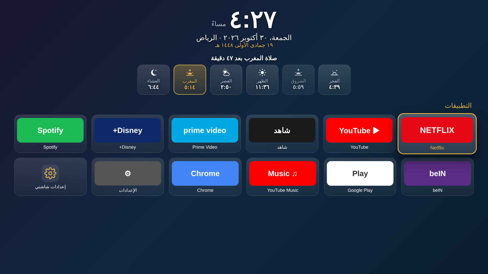
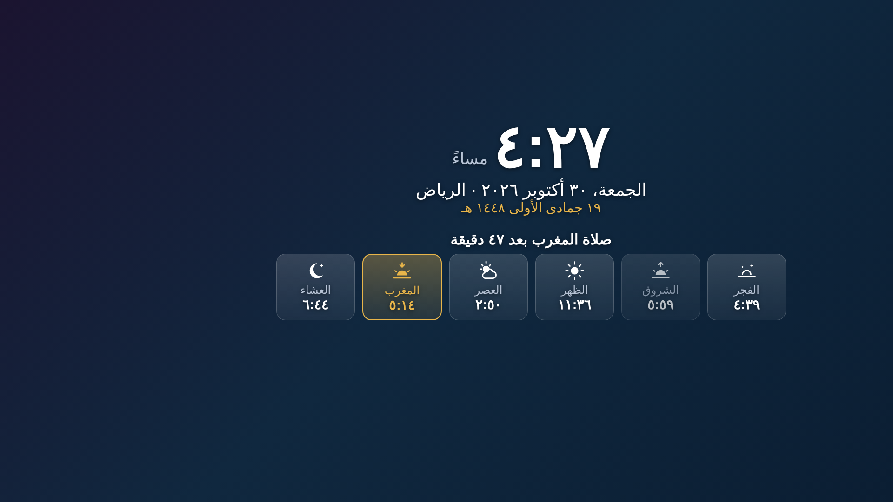

<div dir="rtl">

# شاشتي · Shashati

<p align="center"></p>
<p align="center"></p>

واجهة رئيسية عربية وشاشة توقف لتلفزيونات **Android TV / Google TV**، ومعها سكربتات تخلي التلفزيون أسرع. وتقدر ترجّع كل شي مثل ما كان.

## وش فيها؟

- **الواجهة الرئيسية**: الساعة، والتاريخ الميلادي والهجري (أم القرى)، ومواقيت الصلاة مع عدّاد للصلاة الجاية، وتحتها كل تطبيقات التلفزيون.
- **شاشة التوقف**: نفس المعلومات بخط كبير، وتتحرك كل دقيقة عشان ما تحرق الشاشة.
- **المدن**: الرياض، جدة، مكة، المدينة، الدمام، الكويت، دبي، أبوظبي، الدوحة، المنامة، مسقط، بغداد. لكل مدينة طريقة الحساب المعتمدة فيها.
- **بدون إنترنت**: المواقيت تنحسب في التلفزيون نفسه، والتطبيق ما يطلب أي صلاحية إنترنت.

## التركيب

### ① التلفزيون
الإعدادات ← حول ← اضغط OK على **Build** سبع مرات. بعدها روح **خيارات المطوّر** وشغّل **USB debugging** (أو **Network debugging**)، وخذ عنوان IP حق التلفزيون من إعدادات الشبكة.

### ② الكمبيوتر (على نفس الواي فاي)
ركّب [adb](https://developer.android.com/tools/releases/platform-tools)، ونزّل `shashati.apk` من صفحة **Releases** أو من **Actions**، وحطه في مجلد المشروع. بعدين شغّل:

```bash
./optimize/install.sh 192.168.1.50
```

أول مرة بيطلع لك سؤال على التلفزيون، اضغط **Allow**.

### ③ التسريع (اختياري)
```bash
./optimize/speedup.sh 192.168.1.50
```
يقصّر الأنيميشن ويطفّي التطبيقات اللي في `optimize/packages.txt` وتشتغل في الخلفية بدون فايدة.

### اختيار المدينة
من الواجهة: آخر مربع **«إعدادات شاشتي»**.

## ترجعه مثل ما كان؟
```bash
./optimize/reset.sh 192.168.1.50
```
يرجّع التطبيقات اللي انطفت، والواجهة وشاشة التوقف الأصلية، وسرعة الأنيميشن، ويحذف شاشتي.

## البناء من الكود
```bash
./gradlew assembleRelease
```
يطلع الملف في `app/build/outputs/apk/release/app-release.apk`. ولما ترفع tag مثل `v1.0`، GitHub Actions يبني الـ APK ويحطه في Releases لحاله.

</div>
